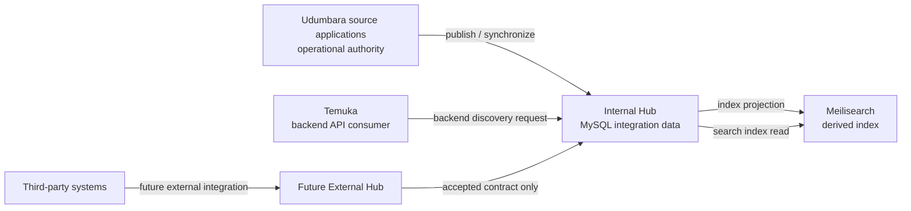

# UIH architecture

This document records the agreed direction for Udumbara Internal Hub (UIH), separates it from proposals, and lists decisions that still need owners. It is a planning document, not an implementation specification.

## Decision labels

- **CONFIRMED** — Explicitly agreed in the UIH architecture brief.
- **PROPOSED** — A recommended direction that still needs review and approval.
- **OPEN** — Requires a product or architecture decision before the affected work begins.

## Vision and scope

**CONFIRMED** — UIH is an internal integration intermediary for Udumbara-owned applications. It will support unified discovery data and, in a later phase, controlled command routing. It must not become the owner of source applications' operational behavior.

**CONFIRMED** — Temuka is a separate consumer-facing application. It communicates with UIH through backend-to-backend APIs. Temuka remains outside UIH's trust boundary and is not a source application merely because it consumes discovery data.

**CONFIRMED** — Larissama (POS and restaurant operations), Laundry, Aset/Properti, and future Udumbara applications remain independent applications with their own operational databases and business authority.

## System boundaries and responsibilities

| Component | Responsibility | Status |
| --- | --- | --- |
| Source SaaS applications | Own operational records, business rules, and decisions for their own domain. Publish or expose approved integration data. | CONFIRMED |
| Internal Hub | Accept integration data from Udumbara-owned applications, maintain normalized integration data in MySQL, provide internal discovery, and eventually route approved commands. | CONFIRMED |
| Meilisearch | Hold a rebuildable, derived search index used for discovery. It is not the transactional system of record. | CONFIRMED |
| Temuka | Consume UIH through backend-to-backend APIs for unified discovery. | CONFIRMED |
| External Hub | A separate future integration boundary for third parties. Its contracts must be accepted by UIH before third-party data can enter UIH. | CONFIRMED direction; details OPEN |

**PROPOSED** — Keep source publication, Hub ingestion, normalization, persistence, indexing, and consumer API responsibilities logically separate. This does not require separate deployable services; deployment boundaries should follow measured needs rather than be decided in this planning phase.

The source-to-Hub synchronization and Hub-to-search projection are **CONFIRMED** directions. Their transport, event format, and operational topology are **OPEN**. The External Hub is future scope; this diagram does not authorize its implementation.

## Data ownership

| Data | Authority / owner | UIH treatment |
| --- | --- | --- |
| Operational transactions and domain rules | The source application that created and governs them | UIH does not replace or directly write around that authority. |
| Normalized integration data | Source remains authoritative for source facts; UIH owns its integration projection and its own processing state | Store in UIH MySQL for integration and discovery needs. Exact retention and correction rules are OPEN. |
| Search documents | Derived from UIH's normalized integration data | Store in Meilisearch as a rebuildable index; never treat it as transactional truth. |
| Consumer-facing discovery response | UIH contract for the discovery result; facts remain attributed to their source | Temuka consumes over the UIH API. Response fields and visibility rules remain OPEN. |
| Command decision and execution | The target source application | UIH may route a request later; the source validates and performs its own business rules. |

**CONFIRMED** — UIH will not query source operational databases for every consumer search. Discovery data is synchronized into UIH and indexed for search.

**CONFIRMED boundary** — Meilisearch is a UIH discovery component. This direction does not require each source SaaS to run or adopt Meilisearch. Which source data participates in unified discovery remains subject to scope and product approval.

## Terms and identity boundaries

These terms are intentionally distinct:

- **Application** — A software system such as Larissama, Laundry, Aset/Properti, UIH, or Temuka.
- **Provider** — **PROPOSED** — An authenticated integration identity through which a source application publishes data to UIH. A provider is not itself a tenant, store, customer, or source record.
- **Tenant** — **OPEN** — A source application's organization or customer isolation boundary. Its exact meaning and identifier are source-specific unless a separately approved mapping says otherwise.
- **Store** — **OPEN** — A source-specific operational location or unit. It must not be assumed to have one universal meaning across applications.

**PROPOSED** — Store source application identifiers and source-scoped tenant/store identifiers with their namespace or provider context. Do not treat equal-looking identifiers from different applications as the same entity. Any cross-application identity mapping requires an explicit contract and decision.

## Security and trust boundaries

- **CONFIRMED** — Source SaaS applications, UIH, Temuka, and the future External Hub are separate applications and must communicate through APIs, not shared operational databases.
- **PROPOSED** — Authenticate every backend caller and bind its credentials to a registered application/provider identity. Authorize each operation against that identity and its allowed data scope.
- **PROPOSED** — Treat provider identity, tenant scope, and store scope as independent authorization dimensions. A caller-supplied identifier alone is not proof of authority.
- **PROPOSED** — Keep credentials out of request bodies and logs; use TLS, secret rotation, request validation, rate controls, audit records for sensitive operations, and explicit data minimization.
- **OPEN** — Select the authentication mechanism (for example, mTLS, OAuth client credentials, or another managed service identity), credential lifecycle, and rotation process.
- **OPEN** — Decide which discovery fields are public to authenticated consumers, whether visibility differs by provider/tenant/store, and how revocation or deletion propagates.

## Architectural principles

1. **CONFIRMED** — Each source application remains authoritative for its own operational data and business rules.
2. **CONFIRMED** — UIH holds normalized integration data in MySQL; Meilisearch is a derived discovery index.
3. **CONFIRMED** — Synchronize discovery data; do not fan out every consumer search to source databases.
4. **CONFIRMED** — Temuka accesses UIH through backend-to-backend contracts.
5. **CONFIRMED** — Third-party integrations belong behind a separate future External Hub boundary and an accepted UIH contract.
6. **PROPOSED** — Make ingestion and indexing replayable and observable before adding more source applications.
7. **PROPOSED** — Prefer the smallest architecture that supports an approved use case; do not introduce service abstractions, queues, schemas, or infrastructure only in anticipation of unapproved features.
8. **PROPOSED** — Define freshness, deletion, retry, and reconciliation behavior as contract requirements, not as accidental behavior of an implementation.

## Explicit non-goals

- UIH does not replace Larissama, Laundry, Aset/Properti, or another source application's operational database or business rules.
- UIH is not Temuka and does not own Temuka's consumer experience.
- Meilisearch is not a transactional database or canonical owner.
- UIH does not directly integrate arbitrary third parties; External Hub is separate future scope.
- This plan does not approve checkout, payment, booking, inquiry, or order ownership.
- This plan does not authorize provider endpoints, domain tables, source adapters, synchronization jobs, search services, or command execution.

## Confirmed decisions and open questions

**CONFIRMED**

- Internal Hub mediates integrations among Udumbara-owned applications.
- Temuka is an API consumer of UIH.
- Source applications retain their operational databases and business authority.
- UIH uses MySQL for normalized integration data and Meilisearch as a derived search index.
- Search data is synchronized instead of queried from each source on every consumer request.
- Controlled command routing is a later capability; the source application keeps its business rules.
- External Hub is a separate future boundary, and UIH must accept its contracts.

**OPEN before implementation**

- Which source application and narrowly bounded data set should be integrated first?
- What is the approved canonical vocabulary and minimum shared discovery record, if any?
- How are application, provider, tenant, store, and source-record identities issued, scoped, and retired?
- Which source publication mechanism is available and acceptable: push API, transactional outbox, polling, or another option?
- What are the freshness, deletion, retention, replay, and reconciliation expectations?
- Which discovery fields can each consumer see, and what are the authorization rules?
- Which API authentication mechanism and operational key lifecycle will be used?
- What measurable latency, availability, throughput, and recovery targets apply?
- Which commands, if any, are in scope later, and how does each source expose its own authorized operation?
- Who owns approval and versioning of contracts between UIH and the future External Hub?
