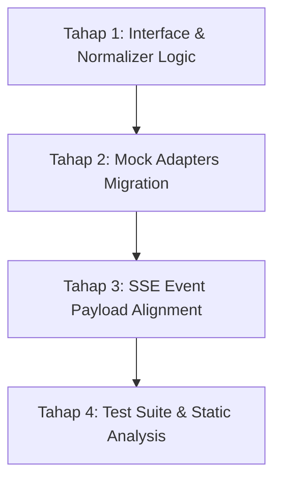

# Implementation Plan — UIH Canonical Catalog Contract v1

**Status:** Plan / Draft  
**Target Repository:** `/home/duro/projects/AIPrijects/uih/api.uih`  
**Dokumen Acuan:** [`docs/architecture/UIH_CANONICAL_CATALOG_CONTRACT_V1.md`](UIH_CANONICAL_CATALOG_CONTRACT_V1.md)  
**Tujuan:** Rencana teknis bertahap untuk memutakhirkan model katalog kanonik di UIH Backend ke spesifikasi Canonical Catalog Contract v1 tanpa mengganggu stabilitas progressive SSE search.

---

## 1. Current State (Kondisi Saat Ini)

### 1.1. Bentuk Payload Item Saat Ini
Saat ini, normalisasi item dilakukan oleh method `CatalogSearchCoordinator::normalizeItem()` dengan skema sebagai berikut:

```php
[
    'source' => [
        'code' => $item['source']['code'] ?? $fallbackSourceCode,
    ],
    'offer' => [
        'id' => (string) ($item['offer']['id'] ?? ''),
        'name' => (string) ($item['offer']['name'] ?? 'Tanpa Nama'),
        'type' => (string) ($item['offer']['type'] ?? 'product'),
        'summary' => isset($item['offer']['summary']) ? (string) $item['offer']['summary'] : null,
    ],
    'provider' => [
        'id' => (string) ($item['provider']['id'] ?? ''),
        'name' => (string) ($item['provider']['name'] ?? 'Tanpa Penyedia'),
    ],
    'image' => isset($item['image']) && is_string($item['image']) ? $item['image'] : null,
    'contact' => [
        'phone' => $item['contact']['phone'] ?? null,
        'whatsapp' => $item['contact']['whatsapp'] ?? null,
        'email' => $item['contact']['email'] ?? null,
    ],
    'location' => [
        'address' => $item['location']['address'] ?? null,
        'latitude' => isset($item['location']['latitude']) ? (float) $item['location']['latitude'] : null,
        'longitude' => isset($item['location']['longitude']) ? (float) $item['location']['longitude'] : null,
        'type' => $item['location']['type'] ?? null,
    ],
    'availability' => $item['availability'] ?? null,
    'operational_status' => $item['operational_status'] ?? null,
]
```

### 1.2. Kesenjangan Field (Gaps & Mismatches)
1. **Field yang Dibuang / Belum Ada di UIH:**
   - `price`: Tidak dinormalisasi sama sekali. Nilai harga yang dikirim oleh adapter dibuang.
   - `category`: Tidak dinormalisasi sama sekali.
   - `code` (item business code): Tidak ada.
   - `provider.code`: Tidak ada.
   - `provider.image`: Tidak ada.
   - `source.name`: Tidak disertakan pada identitas sumber.
   - `meta.total`: Event `source_result` mengirimkan `items_count`, bukan objek `meta: { total: N }`.
2. **Struktur Bersarang yang Perlu Dibenahi (Legacy Nesting):**
   - Atribut produk dibungkus objek `offer` (`offer.id`, `offer.name`, dll). Kontrak v1 meratakannya langsung ke level item (`id`, `name`, dll).
   - `contact` dan `location` diletakkan di root item, padahal secara semantik keduanya adalah atribut milik **provider** (warung/penyedia).
   - `image` saat ini bertipe `string|null` (URL langsung). Kontrak v1 menetapkannya sebagai objek nullable `{"url": "..."}|null`.
   - `operational_status` ada di root item; kontrak v1 menyederhanakannya menjadi enum `availability` (`available` | `unavailable`).
   - `contact.email` dan `location.type` tidak termasuk dalam spesifikasi katalog publik v1.

### 1.3. Kondisi Mock Adapters Saat Ini
Ketiga mock adapter (`MockFastSourceAdapter`, `MockSlowSourceAdapter`, `MockFlakySourceAdapter`) saat ini memancarkan format data lama dengan pembungkus `offer`, tanpa atribut `price` dan `category`, serta menaruh `contact` dan `location` di root item.

### 1.4. Cakupan Tests Saat Ini
- `tests/Unit/CatalogSearchCoordinatorTest.php`:
  - Menguji urutan lifecycle event SSE (`search_init`, `source_result`, `search_done`).
  - Menguji toleransi kegagalan satu adapter tanpa menghentikan adapter lain.
  - Menguji penanganan hasil kosong (`status: completed`, `data: []`).
  - Menguji `normalizeItem()` terhadap skema lama.
  - Menguji per-source timeout handling.
- `tests/Feature/CatalogSearchApiTest.php`:
  - Menguji autentikasi S2S Bearer token.
  - Menguji validasi ketat request (`search_id`, `query`).
  - Menguji streaming respons SSE end-to-end melalui output buffer capture.

### 1.5. Ketergantungan Temuka
- **Temuka Backend (`api.temuka`):** Melakukan pass-through proxy SSE stream, sehingga perubahan payload JSON di dalam event `source_result` tidak mematahkan backend Temuka.
- **Temuka Frontend (`web.temuka` / `ProductCard.vue`):**
  - Saat ini membaca `props.item.offer?.name || props.item.name`.
  - Membaca `props.item.location?.address || props.item.location`.
  - Membaca `props.item.image` sebagai URL string.
  - Mengharapkan `props.item.price` (saat ini undefined dari UIH).
  - Melakukan fallback `category` berdasarkan `source.code`.

---

## 2. Target State (Kondisi Sasaran)

Struktur data keluaran UIH akan mengikuti spesifikasi resmi pada `docs/architecture/UIH_CANONICAL_CATALOG_CONTRACT_V1.md`:

### 2.1. Root Envelope Event `source_result`
```json
{
  "search_id": "search_1730700000_abcde",
  "status": "completed",
  "source": {
    "code": "larissama",
    "name": "Larissama"
  },
  "data": [
    {
      "id": "101",
      "code": "MKN-001",
      "name": "Nasi Goreng",
      "category": "Makanan",
      "summary": null,
      "price": {
        "amount": 25000,
        "currency": "IDR"
      },
      "image": null,
      "availability": "available",
      "provider": {
        "id": "10",
        "code": "WRG-001",
        "name": "Warung Contoh",
        "image": null,
        "contact": {
          "phone": null,
          "whatsapp": null
        },
        "location": {
          "address": null,
          "latitude": null,
          "longitude": null
        }
      }
    }
  ],
  "meta": {
    "total": 1
  },
  "items_count": 1
}
```
*(Catatan: `items_count` dipertahankan berdampingan dengan `meta.total` selama masa transisi demi kompatibilitas frontend).*

### 2.2. Definisi Nullability
Semua field nullable (`code`, `category`, `summary`, `image`, `provider.code`, `provider.image`, `provider.contact.*`, `provider.location.*`) **wajib hadir secara eksplisit di JSON dengan nilai `null`**, bukan dihilangkan (*omitted*).

---

## 3. File-Level Change Plan

Berikut adalah daftar file riil yang akan dimodifikasi pada sesi implementasi:

| File | Kondisi Sekarang | Perubahan yang Direncanakan | Risiko | Tests Terkait |
|---|---|---|---|---|
| `app/Services/Catalog/CatalogSearchCoordinator.php` | `normalizeItem()` menghasilkan skema lama (`offer`, `contact` di root, tanpa `price`). `executeStream()` memancarkan `source_result` tanpa objek `source` dan `meta`. | 1. Tulis ulang `normalizeItem()` untuk menghasilkan struktur item kanonik v1 lengkap.<br>2. Tambahkan backward-compatible reading (menerima input model lama dari adapter dan menghasilkan output model v1).<br>3. Perbarui payload `source_result` agar menyertakan `source: { code, name }` dan `meta: { total }`. | Perubahan bentuk payload JSON pada event SSE stream. | `tests/Unit/CatalogSearchCoordinatorTest.php`<br>`tests/Feature/CatalogSearchApiTest.php` |
| `app/Contracts/Catalog/SourceAdapterInterface.php` | PHPDoc mendefinisikan return type `search()` secara umum tanpa rincian field v1. | Perbarui PHPDoc array shape return type untuk mencakup struktur item v1 (`price`, `category`, `provider`, dll). | Sangat rendah (hanya static typing / PHPDoc). | Static analysis / PHPStan. |
| `app/Services/Catalog/Adapters/MockFastSourceAdapter.php` | Menghasilkan data mock kuliner format lama (`offer`, tanpa harga). | Perbarui mock data kuliner ke struktur v1: tambahkan `code`, `category: 'Makanan Utama'/'Minuman'`, `price: { amount: 25000/5000, currency: 'IDR' }`, `image: { url: '...' }`, dan restrukturisasi `provider`. | Rendah. | `CatalogSearchCoordinatorTest`<br>`CatalogSearchApiTest` |
| `app/Services/Catalog/Adapters/MockSlowSourceAdapter.php` | Menghasilkan data mock laundry format lama. | Perbarui mock data laundry ke struktur v1: tambahkan `category: 'Laundry'`, `price: { amount: 15000, currency: 'IDR' }`, dll. | Rendah. | `CatalogSearchCoordinatorTest` |
| `app/Services/Catalog/Adapters/MockFlakySourceAdapter.php` | Menghasilkan data mock properti format lama. | Perbarui mock data properti ke struktur v1: tambahkan `category: 'Properti'`, `price: { amount: 850000000, currency: 'IDR' }`, dll. | Rendah. | `CatalogSearchCoordinatorTest` |
| `tests/Unit/CatalogSearchCoordinatorTest.php` | Assertion `test_normalizes_items_to_canonical_catalog_model` memeriksa key format lama (`offer.id`, dll). | 1. Perbarui assertion normalisasi ke struktur v1.<br>2. Tambahkan unit tests baru untuk validasi harga (integer $\ge 0$), objek image `{ url }`, dan nullability contract. | Rendah (sinkronisasi test dengan spesifikasi baru). | `tests/Unit/CatalogSearchCoordinatorTest.php` |
| `tests/Feature/CatalogSearchApiTest.php` | `test_streams_catalog_search_events_successfully` hanya memeriksa teks event dasar. | Perbarui assertion untuk memverifikasi kemunculan key kanonik v1 (`price`, `category`, `provider`) dalam chunk stream SSE. | Rendah. | `tests/Feature/CatalogSearchApiTest.php` |

---

## 4. Normalization Rules (Aturan Normalisasi)

Method `normalizeItem(array $item, string $fallbackSourceCode, string $fallbackSourceName = '')` akan menerapkan prinsip:  
**"Permissive in what it receives, strict in what it emits"** (Menerima variasi input adapter lama maupun baru, dan selalu menghasilkan output kanonik v1 yang ketat).

### 4.1. Aturan Field per Field
1. **Identitas Item (`id` & `code`):**
   - `id`: `(string) ($item['id'] ?? $item['offer']['id'] ?? '')`.
   - `code`: `isset($item['code']) ? (string) $item['code'] : (isset($item['offer']['code']) ? (string) $item['offer']['code'] : null)`.
2. **Nama & Kategori & Ringkasan:**
   - `name`: `(string) ($item['name'] ?? $item['offer']['name'] ?? 'Tanpa Nama')`.
   - `category`: `isset($item['category']) ? (string) $item['category'] : null`.
   - `summary`: `isset($item['summary']) ? (string) $item['summary'] : (isset($item['offer']['summary']) ? (string) $item['offer']['summary'] : null)`.
3. **Harga (`price`):**
   - Format kanonik: `['amount' => int, 'currency' => string]`.
   - Aturan konversi:
     - Jika input berupa array `['amount' => 25000, 'currency' => 'IDR']`: ambil nilainya.
     - Jika input berupa angka/numeric skalar (`$item['price'] = 25000`): konversi ke integer.
     - Validasi `amount >= 0`: gunakan `max(0, (int) $amount)`. Jika tidak tersedia, default ke `0`.
     - Validasi `currency`: string ISO 4217, default ke `'IDR'` jika kosong atau null.
4. **Gambar (`image`):**
   - Format kanonik: `['url' => string] | null`.
   - Aturan konversi:
     - Jika input berupa string URL: `['url' => trim($item['image'])]` (jika non-empty).
     - Jika input berupa array dengan key `url`: `['url' => (string) $item['image']['url']]`.
     - Jika null, empty string, atau format lain: `null`.
5. **Availability:**
   - Format kanonik: `'available' | 'unavailable'`.
   - Aturan konversi:
     - Jika bernilai boolean `true` atau string `'available'`: `'available'`.
     - Selain itu: `'unavailable'`.
6. **Provider:**
   - `id`: `(string) ($item['provider']['id'] ?? '')`.
   - `code`: `isset($item['provider']['code']) ? (string) $item['provider']['code'] : null`.
   - `name`: `(string) ($item['provider']['name'] ?? 'Tanpa Penyedia')`.
   - `image`: format objek `{ 'url': string } | null` (aturan sama dengan item image).
   - `contact`:
     - `phone`: `isset($item['provider']['contact']['phone']) ? (string) $item['provider']['contact']['phone'] : ($item['contact']['phone'] ?? null)`.
     - `whatsapp`: `isset($item['provider']['contact']['whatsapp']) ? (string) $item['provider']['contact']['whatsapp'] : ($item['contact']['whatsapp'] ?? null)`.
   - `location`:
     - `address`: `isset($item['provider']['location']['address']) ? (string) $item['provider']['location']['address'] : ($item['location']['address'] ?? null)`.
     - `latitude`: `isset($item['provider']['location']['latitude']) ? (float) $item['provider']['location']['latitude'] : (isset($item['location']['latitude']) ? (float) $item['location']['latitude'] : null)`.
     - `longitude`: `isset($item['provider']['location']['longitude']) ? (float) $item['provider']['location']['longitude'] : (isset($item['location']['longitude']) ? (float) $item['location']['longitude'] : null)`.

### 4.2. Penanganan Input Cacat (Invalid Handling Policy)
- **Item Cacat:** Jika item tidak memiliki identitas atau data corrupt total (misalnya `id` dan `name` kosong), item tersebut tetap dinormalisasi dengan nilai default yang aman (`'Tanpa Nama'`), tanpa menggugurkan item lain dalam batch sumber tersebut.
- **Adapter Failure:** Jika adapter mengalami unhandled exception atau timeout, coordinator menangkapnya dan memancarkan event `source_failed`, sehingga adapter lain tetap dapat mengalirkan hasil.

---

## 5. Mock Adapter Migration Plan

Ketiga mock adapter akan dimigrasikan secara simultan agar seluruh respons konsisten pada kontrak v1:

1. **`MockFastSourceAdapter` (`mock_larissama`):**
   - Nama sumber: `'Larissama F&B'`.
   - Item 1: Nasi Goreng Spesial, `id: 'lrs-001'`, `code: 'MNU-001'`, `category: 'Makanan Utama'`, `price: { amount: 25000, currency: 'IDR' }`, `image: { url: 'https://...' }`.
   - Item 2: Es Teh Manis Segar, `id: 'lrs-002'`, `code: 'MNU-002'`, `category: 'Minuman'`, `price: { amount: 5000, currency: 'IDR' }`, `image: { url: 'https://...' }`.
   - Provider: Warung Makan Bu Rina, `id: 'tenant-lrs-10'`, `code: 'WRG-001'`, kontak telepon dan WhatsApp terisi, lokasi terisi lengkap.
2. **`MockSlowSourceAdapter` (`mock_laundry`):**
   - Nama sumber: `'Laundry Kilat'`.
   - Item: Paket Cuci Setrika Kiloan, `id: 'lnd-001'`, `code: 'LND-001'`, `category: 'Jasa Laundry'`, `price: { amount: 15000, currency: 'IDR' }`, `image: { url: 'https://...' }`.
   - Provider: Laundry Bersih Berkah, `id: 'tenant-lnd-05'`, `code: 'LND-PRV-01'`.
3. **`MockFlakySourceAdapter` (`mock_aset`):**
   - Nama sumber: `'Aset & Properti'`.
   - Item: Rumah Cantik 2 Lantai Siap Huni, `id: 'ast-001'`, `code: 'AST-001'`, `category: 'Properti'`, `price: { amount: 850000000, currency: 'IDR' }`, `image: { url: 'https://...' }`.
   - Provider: Properti Nusantara Mandiri, `id: 'tenant-ast-01'`, `code: 'AST-PRV-01'`.
   - Simulasi kegagalan (`'error'`) dan hasil kosong (`'kosong'`) tetap dipertahankan untuk menguji ketahanan SSE.

---

## 6. SSE Compatibility & Invariants

Implementasi kontrak v1 wajib menjaga seluruh invarian progressive search yang sudah stabil:

1. **Urutan Event SSE Tetap Terjaga:**
   ```text
   event: search_init    --> targets list
   event: source_result  --> data per source (progressive)
   event: source_failed  --> jika sumber error/timeout
   event: search_done    --> summary & total
   ```
2. **Latest Search Wins:**
   - Properti `search_id` selalu disertakan di seluruh event (`search_init`, `source_result`, `source_failed`, `search_done`).
   - Temuka frontend tetap dapat membandingkan `event.search_id === activeSearchId` untuk mengabaikan stream yang sudah basi (*stale*).
3. **Penyelarasan Payload `source_result`:**
   - Objek `source` sekarang memuat `{ "code": "...", "name": "..." }`.
   - Objek `meta` memuat `{ "total": <count> }`.
   - Nilai `items_count` tetap dipertahankan di root payload sebagai alias backward-compatible.
4. **Zero Caching:**
   - UIH tetap berjalan secara *pass-through* tanpa caching respons pada v1.

---

## 7. Test Plan

### 7.1. Existing Tests yang Disesuaikan
- `tests/Unit/CatalogSearchCoordinatorTest.php`:
  - `test_executes_all_adapters_and_emits_expected_events`: Sesuaikan assertion untuk memverifikasi keberadaan `source.name` dan `meta.total`.
  - `test_normalizes_items_to_canonical_catalog_model`: Perbarui dari skema lama (`offer.id`) ke skema kanonik v1 (`id`, `code`, `name`, `category`, `price.amount`, `price.currency`, `image.url`, `availability`, `provider.contact`, `provider.location`).
- `tests/Feature/CatalogSearchApiTest.php`:
  - `test_streams_catalog_search_events_successfully`: Tambahkan assertion bahwa chunk output SSE memuat `"price"` dan `"provider"`.

### 7.2. New Tests yang Direncanakan
Tambahkan test method baru pada `tests/Unit/CatalogSearchCoordinatorTest.php`:
1. `test_normalizes_price_to_integer_rupiah_and_iso_currency`:
   - Memastikan angka positif di-cast ke int.
   - Memastikan angka negatif dinormalisasi menjadi `0`.
   - Memastikan default currency `'IDR'`.
2. `test_normalizes_image_to_nullable_object`:
   - Input string URL `https://...` menjadi `['url' => 'https://...']`.
   - Input array `['url' => 'https://...']` menjadi `['url' => 'https://...']`.
   - Input `null` / kosong tetap `null`.
3. `test_ensures_all_nullable_fields_present_as_null`:
   - Menjamin bahwa key `code`, `category`, `summary`, `image`, `provider.code`, `provider.image`, `provider.contact.whatsapp`, dll tetap ada di array dengan value `null`.
4. `test_backward_compatible_with_legacy_adapter_structure`:
   - Menjamin jika adapter mengirim struktur lama (`offer.name`, root `location`), normalizer tetap menghasilkan output kanonik v1 dengan benar.

---

## 8. Tahapan Implementasi yang Direkomendasikan

Implementasi harus dieksekusi secara berurutan dalam batch perubahan terisolasi:



### Tahap 1: Interface & Normalizer Logic
- **Tujuan:** Memutakhirkan `normalizeItem()` pada `CatalogSearchCoordinator` dan PHPDoc pada `SourceAdapterInterface`.
- **File:**
  - `app/Contracts/Catalog/SourceAdapterInterface.php`
  - `app/Services/Catalog/CatalogSearchCoordinator.php`
- **Tests:** Jalankan unit test normalizer.
- **Kriteria Selesai:** Method `normalizeItem()` menghasilkan struktur kanonik v1 lengkap dengan penanganan fallback yang aman.

### Tahap 2: Mock Adapters Migration
- **Tujuan:** Menyelaraskan seluruh data tiruan di ketiga mock adapter agar memancarkan format v1 yang konsisten.
- **File:**
  - `app/Services/Catalog/Adapters/MockFastSourceAdapter.php`
  - `app/Services/Catalog/Adapters/MockSlowSourceAdapter.php`
  - `app/Services/Catalog/Adapters/MockFlakySourceAdapter.php`
- **Tests:** Jalankan unit test coordinator dengan mock adapters.
- **Kriteria Selesai:** Tidak ada lagi adapter yang menghasilkan format legacy.

### Tahap 3: SSE Event Payload Alignment (`source_result`)
- **Tujuan:** Memperbarui payload event SSE `source_result` di `CatalogSearchCoordinator::executeStream()` agar menyertakan objek `source` dan `meta.total`.
- **File:**
  - `app/Services/Catalog/CatalogSearchCoordinator.php`
- **Tests:** Jalankan feature test SSE stream (`CatalogSearchApiTest`).
- **Kriteria Selesai:** Event `source_result` memancarkan struktur v1 beserta alias backward-compatible `items_count`.

### Tahap 4: Test Suite & Static Analysis Verification
- **Tujuan:** Menambahkan automated tests baru untuk seluruh aturan validasi v1, menjalankan seluruh test suite UIH, dan formatting Pint.
- **File:**
  - `tests/Unit/CatalogSearchCoordinatorTest.php`
  - `tests/Feature/CatalogSearchApiTest.php`
- **Command:**
  - `docker exec uih-test php artisan test`
  - `docker exec uih-dev vendor/bin/pint --test`
- **Kriteria Selesai:** Seluruh unit & feature tests PASS 100%, 0 lint error.

---

## 9. Risiko dan Open Questions

### 9.1. Risiko Teridentifikasi
1. **Dampak Tampilan pada Temuka Frontend:**
   - Komponen `ProductCard.vue` di `web.temuka` membaca `props.item.offer?.name` dan `props.item.location?.address`.
   - *Mitigasi:* Pada tahap UIH ini, normalizer menghasilkan `name` di level item dan `provider.location.address`. Pada sesi frontend berikutnya, `ProductCard.vue` akan dimutakhirkan untuk membaca field baru ini.
2. **Kompatibilitas Event SSE Consumer:**
   - Composable frontend membaca `event.items_count`.
   - *Mitigasi:* UIH akan memancarkan `items_count` berdampingan dengan `meta: { total: N }` di event `source_result`.

### 9.2. Open Questions & Rekomendasi
1. **Pertanyaan:** Apakah properti `operational_status` (misal `'open'`) masih perlu dipertahankan sebagai field opsional, atau sepenuhnya dihilangkan dan dilebur ke dalam enum `availability: 'available'|'unavailable'`?  
   - **Rekomendasi:** Sepenuhnya lebur ke dalam `availability` sesuai kontrak resmi v1, untuk menghindari redundansi state.
2. **Pertanyaan:** Apakah UIH perlu menolak satu item jika `price.amount` hilang dari adapter sumber, atau menormalisasinya menjadi `0`?  
   - **Rekomendasi:** Normalisasi ke `0` dengan log warning internal, agar satu menu tanpa harga tidak menggagalkan seluruh hasil pencarian warung tersebut.
