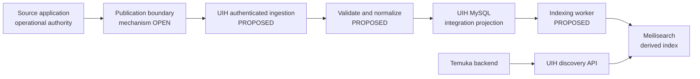

# UIH data flow

This is a planning model for discovery synchronization and a later command-routing capability. It does not define a production protocol or authorize implementation.

## Status labels

- **CONFIRMED** — Explicitly agreed direction.
- **PROPOSED** — Recommended flow or behavior, pending approval.
- **OPEN** — Choice or policy that needs a decision.

## Discovery publication and synchronization

**CONFIRMED** — Discovery data is synchronized into UIH. UIH does not issue a live query to every source application's operational database for each Temuka search.

**PROPOSED** — Use a durable, retryable source publication path, then validate and normalize accepted source data into a UIH-owned MySQL integration projection. Index that projection into Meilisearch asynchronously. Keep the source application as authority for source facts and the UIH MySQL projection as authority only for UIH's accepted integration state.

The storage roles and synchronization direction are **CONFIRMED**. Named components and asynchronous worker behavior are **PROPOSED**, not mandatory deployment units.

### Candidate processing sequence

1. **Publish — OPEN mechanism.** A source application emits a change or sends a snapshot through an approved contract. Candidates include push API, transactional outbox delivery, polling, or another source-supported mechanism. CDC is not assumed.
2. **Authenticate and scope — PROPOSED.** UIH establishes the caller's registered application/provider identity and verifies allowed scopes before accepting data. Tenant and store identifiers remain source-scoped.
3. **Validate — PROPOSED.** Check contract version, required envelope fields, payload shape, limits, and source identity. Reject unsupported or unauthorized input with a traceable error.
4. **Normalize and persist — CONFIRMED direction; details OPEN.** Map accepted fields into a deliberately bounded integration projection in UIH MySQL. Preserve source identity and enough version/time metadata to detect duplicates and stale updates. Exact normalized fields and history policy require approval.
5. **Acknowledge — PROPOSED.** Acknowledge only once UIH has durably accepted responsibility for the delivery. If processing is asynchronous, distinguish “accepted” from “indexed” or “complete.”
6. **Index — CONFIRMED direction; mechanism PROPOSED.** Build or update Meilisearch documents from committed MySQL projection state. Indexing can lag without changing transactional ownership.
7. **Consume — CONFIRMED.** Temuka calls UIH backend APIs. UIH searches the derived index and returns only records permitted by the approved consumer scope.

## MySQL projection and search index

**CONFIRMED** — UIH MySQL stores normalized integration data; Meilisearch is derived and rebuildable. Search index results do not authorize a business operation and are not a source of transaction truth.

**PROPOSED** — Persist enough state to support idempotent ingestion, source version ordering, index retry, deletion propagation, and reconciliation. A transactional outbox is one candidate for reliable MySQL-to-index delivery; a simpler polling/rebuild strategy may be sufficient at low volume. Choose after workload and recovery requirements are known.

**OPEN** — Decide whether UIH stores current state only or also a change history; how source deletes and tombstones work; whether stale updates are rejected or retained for review; which fields are searchable/filterable; and how index schema changes are rolled out.

**PROPOSED** — Index rebuild should read accepted UIH MySQL state. It should not require access to source operational databases to recreate UIH's current search index. If UIH's stored projection is incomplete or invalid, source reconciliation is a separate recovery process.

**CONFIRMED boundary** — Meilisearch is for UIH discovery; source SaaS applications are not required to run or adopt it. The participating source data set remains an explicit scope decision.

## Temuka search request

**CONFIRMED** — Temuka is a backend-to-backend consumer of UIH.

**PROPOSED** — Temuka authenticates to a versioned UIH discovery API and sends a bounded query, filters, and pagination cursor. UIH authorizes the consumer, queries Meilisearch within its permitted scope, and returns a stable response envelope. Search results should identify their source and freshness metadata where approved; they should not imply that a booking, price, availability, or transaction is guaranteed.

**OPEN** — Query syntax, searchable fields, ranking, filters, localization, pagination limits, response freshness markers, and consumer-specific authorization remain to be agreed.

## Freshness and eventual consistency

**CONFIRMED** — Synchronization plus a derived search index means discovery can be eventually consistent rather than a real-time view of each source database.

**PROPOSED** — Track source event/version time and UIH receipt/processing/index times separately. Expose a meaningful freshness indicator or timestamp to consumers once semantics are agreed. Measure lag and failed deliveries; avoid promising a freshness SLA until it is approved.

**OPEN** — Set maximum acceptable lag by data category, decide whether a consumer may request a refresh, define how conflicting or out-of-order updates are resolved, and decide whether stale data is hidden, returned with a warning, or handled another way.

## Error handling and recovery

| Failure | Proposed handling | Decision still needed |
| --- | --- | --- |
| Source cannot publish | Source retries with bounded backoff and retains undelivered work; UIH monitors delivery gaps. | Retry ownership, backoff, dead-letter handling, and alert thresholds. |
| Authentication or scope rejected | Reject without accepting the payload; log a safe audit event and correlation identifier. | Credential suspension and operator review process. |
| Invalid or unsupported contract | Return field-level validation details without exposing internals; do not partially apply a record. | Quarantine versus caller correction for repeated errors. |
| Duplicate delivery | Detect through an approved idempotency/source version identity and return a stable result. | Exact key scope, retention period, and duplicate response semantics. |
| Out-of-order update | Compare approved source sequence/version metadata before changing the projection. | Source guarantees, version comparison, and conflict resolution. |
| MySQL unavailable | Do not acknowledge durable acceptance; retry after recovery. | Availability target and caller retry window. |
| Indexing fails after MySQL commit | Preserve projection state and retry indexing; rebuild the index from MySQL if needed. | Retry schedule, backlog limits, and rebuild cutover procedure. |
| Search index unavailable | Return a controlled service error; do not silently query every source database as fallback. | Whether a limited MySQL fallback is acceptable for specific approved queries. |
| Source deletes or revokes a record | Propagate a tombstone/deletion through the projection and derived index. | Deletion authorization, retention, and audit requirements. |
| Projection diverges from source | Compare source and UIH state using an approved reconciliation process; repair through normal ingestion rules. | Snapshot format, cadence, conflict authority, and repair approval. |

**PROPOSED** — Make replay and reconciliation safe by applying the same validation, identity, version, and authorization rules as normal ingestion. A repair path must not silently overwrite source-owned business state.

## Reconciliation candidate

**PROPOSED** — For each provider/source scope, compare a bounded source snapshot or source change watermark with UIH's accepted records. Detect missing, stale, and orphaned projection records; report differences first; apply repairs only under an approved policy. Rebuild Meilisearch from UIH MySQL independently of source reconciliation.

**OPEN** — Choose snapshot versus watermark-based reconciliation, full versus incremental scope, how deletes are proven, and whether repairs are automatic or operator-approved.

## Candidate command-routing flow (later phase)

**CONFIRMED** — UIH may eventually support controlled command routing to source applications, but the source application retains its business rules. Command routing is not part of discovery synchronization or M3 planning implementation.

**PROPOSED** — A consumer submits an authorized command request to UIH; UIH authenticates the consumer, checks its permitted provider/source scope, validates a stable command contract, and forwards it to the target source API. The source rechecks current authority and business conditions, performs the operation using its own transaction rules, and returns an outcome. UIH records correlation and delivery status without claiming a source-side success before the source confirms it.

**OPEN** — Which command types are permitted; which consumer can invoke each; whether UIH stores command status; source timeout and retry semantics; how uncertain outcomes are reconciled; and what human approval or audit is required.

### Command failure cases to design before implementation

- Source rejects the command because business state changed: return the source's safe rejection contract; do not reinterpret it.
- UIH times out after forwarding: outcome may be unknown. Do not blindly resend unless the source contract supports the same idempotency identity.
- Consumer retries: deduplicate according to the approved command idempotency scope and return the known or pending outcome.
- Source is unavailable: report a retryable/unavailable result without substituting UIH-owned business logic.
- UIH loses its local status update after source success: query or reconcile using the command identity; avoid duplicate execution.
- Authorization changes while pending: define whether authorization is checked at submission, execution, or both.

## Alternatives to keep open

- **Publication:** direct push API, source transactional outbox plus delivery, UIH polling, or another source-supported mechanism. Each trades source coupling, delivery delay, replay control, and operational cost differently.
- **Index delivery:** transactional outbox, queue, or scheduled polling/rebuild. Choose based on required lag and failure recovery; none is approved yet.
- **Reconciliation:** full snapshots, incremental watermarks, or both. Source capabilities and data size should determine the approach.
- **Search outage behavior:** return a controlled unavailable response or use a narrowly defined MySQL fallback. Never make per-request fan-out to all source databases the implicit fallback.
